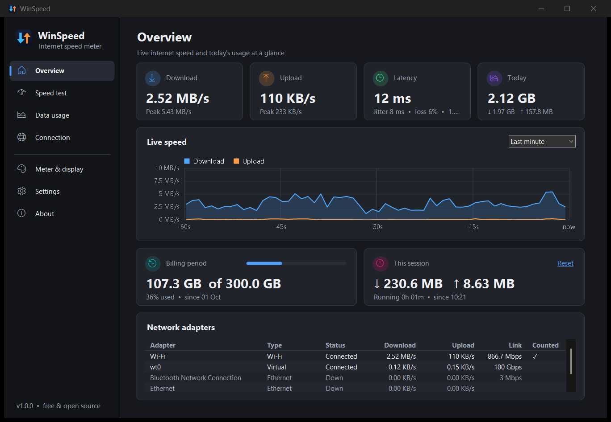
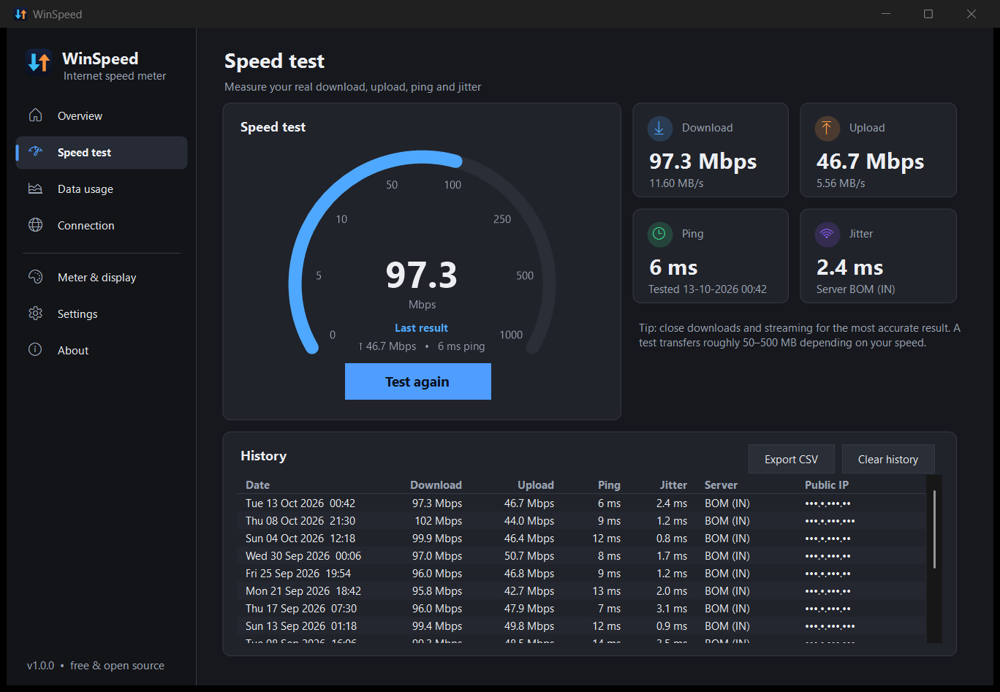
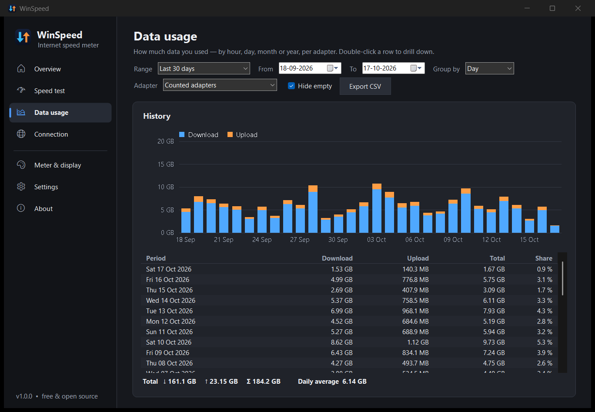
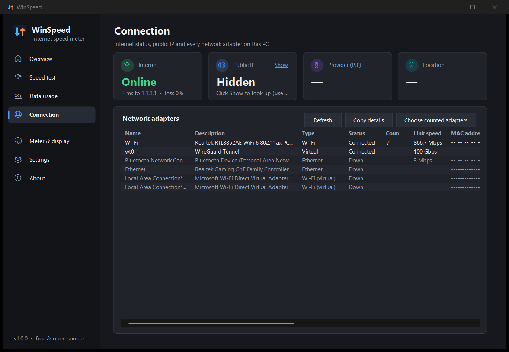
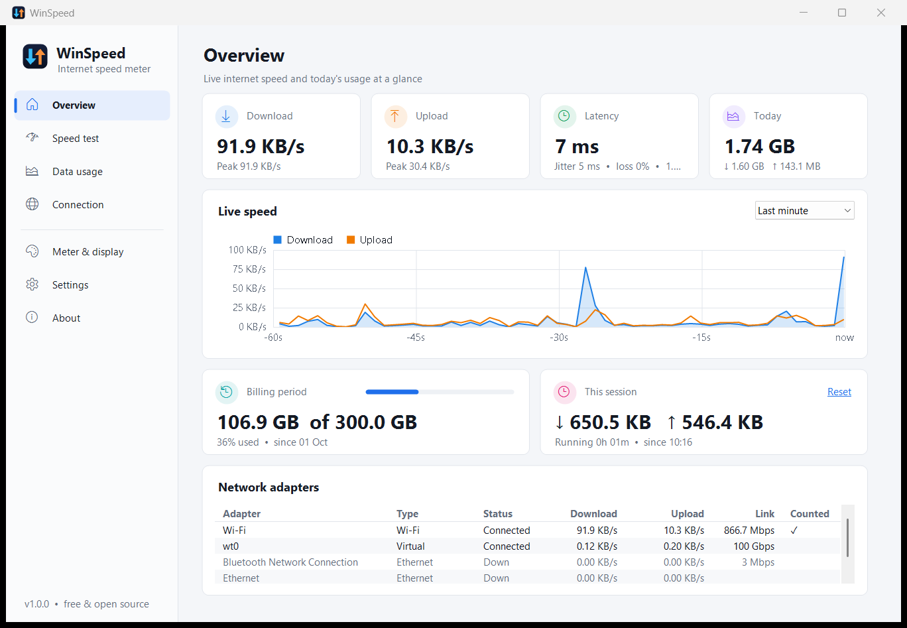
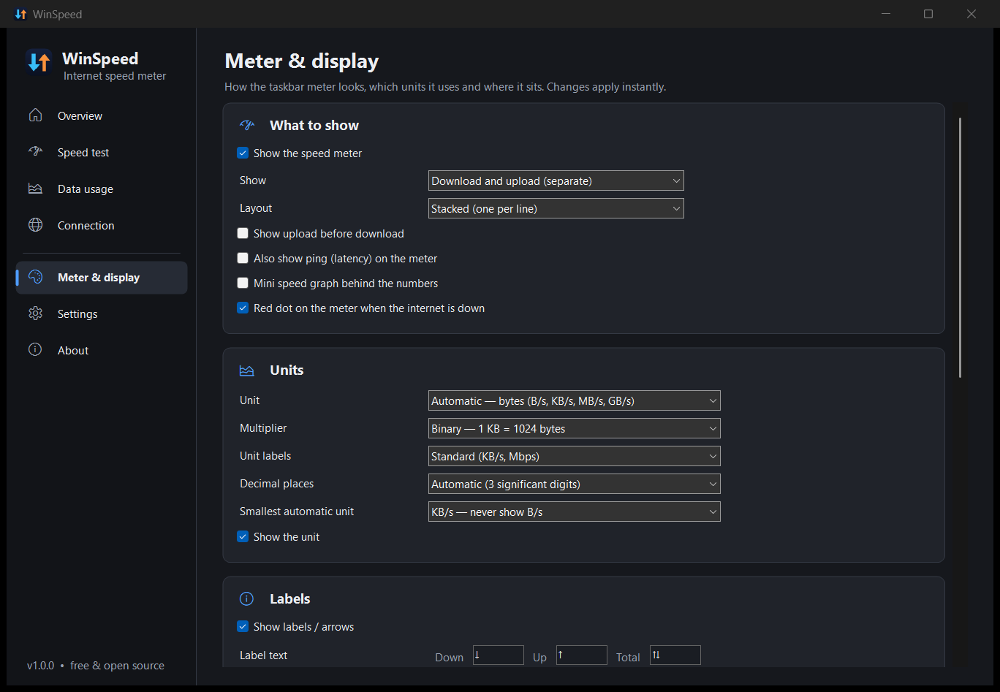
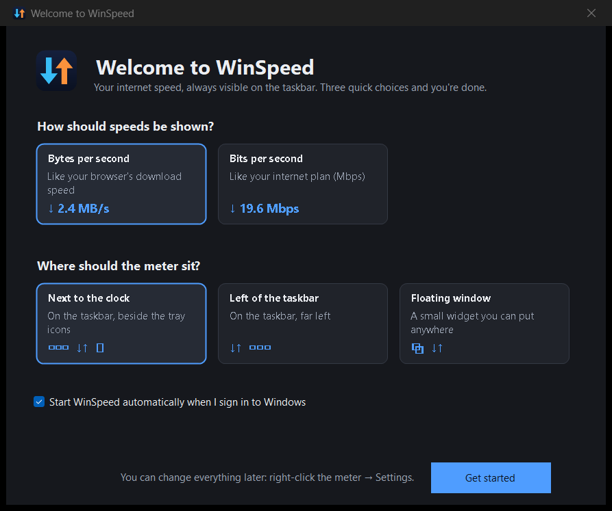
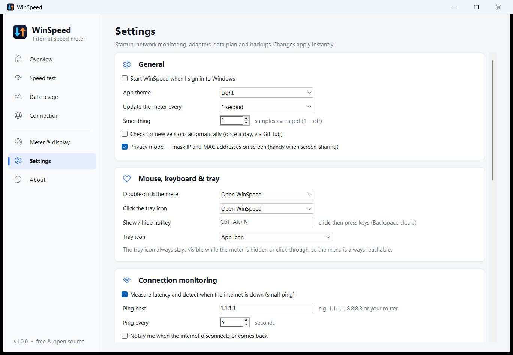

<p align="center">
  
</p>

<h1 align="center">WinSpeed</h1>

<p align="center">
  <b>Your internet speed, right on the Windows taskbar.</b><br>
  A tiny, free and open-source speed meter with speed tests, data-usage history and data-cap alerts.
</p>

<p align="center">
  <a href="https://github.com/anand34577/winspeed/releases/latest"></a>
  <a href="https://github.com/anand34577/winspeed/releases"></a>
  <a href="https://github.com/anand34577/winspeed/actions/workflows/ci.yml"></a>
  
  <a href="LICENSE"></a>
</p>

<p align="center">
  <a href="https://github.com/anand34577/winspeed/releases/latest"><b>⬇ Download for Windows</b></a> ·
  <a href="https://anand34577.github.io/winspeed/">Website</a> ·
  <a href="https://github.com/anand34577/winspeed/wiki">User guide</a> ·
  <a href="https://github.com/anand34577/winspeed/issues/new/choose">Report an issue</a>
</p>

<p align="center">
  
</p>

<p align="center">
  
</p>

## Why WinSpeed

- **Always visible.** Live download and upload speed sits on the taskbar next to the clock, on Windows 10 and 11, light or dark.
- **Featherweight.** One ~250 KB exe, about 20 MB of RAM, near-zero CPU. No runtime to install, no admin rights.
- **More than a meter.** Speed test, hour-by-hour data history, data-cap alerts, latency and offline notifications.
- **Yours to shape.** Units, labels, fonts, colours, layout and position are all adjustable, and every change applies instantly.
- **Private.** No telemetry, no ads, no account. Your data stays in plain-text files on your PC.

## Features

<table>
<tr>
<td width="50%" valign="top">

### 📊 Taskbar meter
- Download / upload, combined, or both plus total
- Stacked or single-line layout
- **Auto bytes** (KB/s, MB/s) or **auto bits** (Kbps, Mbps), or any fixed unit
- 1024 or 1000 multiplier, standard, compact or IEC labels
- Custom labels, fonts, colours and background opacity
- Mini graph, ping and offline dot on the meter
- Drag anywhere, lock it, click-through, floating mode
- Hides during full-screen games and videos

</td>
<td width="50%" valign="top">

### ⚡ Speed test
- Download, upload, ping and jitter in about 25 seconds
- Multi-stream test on Cloudflare's global network
- Live gauge, result history and CSV export
- Run on a schedule with `--run-speedtest`



</td>
</tr>
<tr>
<td valign="top">

### 📈 Data usage
- Recorded per hour and per adapter
- View by hour, day, month or year, for any date range
- Filter by adapter; drill down month → day → hour
- Bar chart, totals, daily average, CSV export



</td>
<td valign="top">

### 🔔 Limits & connection
- Monthly and daily data limits with your billing day
- Notifications at your warning level and at 100 %
- Latency, jitter and packet-loss monitoring
- "Connection lost / restored" notifications
- Public IP, ISP and location on request
- Privacy mode masks IP and MAC addresses



</td>
</tr>
</table>

### And the details that matter

- **Smart adapter counting:** VPN and virtual adapters (WireGuard, OpenVPN, Hyper-V, WSL, Docker…) are skipped automatically so traffic isn't counted twice. You can also pick adapters by hand.
- **Welcome screen:** three quick choices on first run, and you're done.
- **Light and dark theme** that follows Windows.
- **Live-speed tray icon**, global **hotkey** (Ctrl+Alt+N), configurable click actions.
- **Portable mode:** run from a USB stick with everything in one folder.
- **Export and import settings**; all settings in a readable `settings.ini`.
- **Daily update check** via GitHub releases (can be turned off).

## Screenshots

| | |
|---|---|
|  |  |
| **Overview** in the light theme | **Meter & display**: every option applies instantly |
|  |  |
| **Welcome screen** on first run | **Settings**: startup, monitoring, adapters, data plan |

<p align="center">
  
  
</p>

## Install

1. Download **`WinSpeed-Setup-x.y.z.exe`** from the [latest release](https://github.com/anand34577/winspeed/releases/latest) and run it. No admin rights needed.
2. The meter appears on your taskbar. **Right-click it** for the menu; **double-click** to open WinSpeed.

Prefer not to install? Grab **`WinSpeed-Portable-x.y.z.zip`**, unzip and run `WinSpeed.exe`.

> The installer isn't code-signed yet, so SmartScreen may ask you to confirm: **More info → Run anyway**. Every release is built from this repository by GitHub Actions and ships with `SHA256SUMS.txt`.

**Requirements:** Windows 10 or 11. Nothing else.

## Documentation

The **[user guide](https://github.com/anand34577/winspeed/wiki)** covers installation, every setting, units, the speed test, data limits, the command line, portable mode, privacy and troubleshooting.

## Build from source

```powershell
git clone https://github.com/anand34577/winspeed.git
cd winspeed
./build.ps1        # → dist\WinSpeed-Setup-x.y.z.exe, dist\WinSpeed-Portable-x.y.z.zip
```

Needs the .NET SDK 8+ (and Inno Setup 6 for the installer). See [Building from source](https://github.com/anand34577/winspeed/wiki/Building-from-Source).

## Contributing

Issues and pull requests are welcome. See [CONTRIBUTING.md](CONTRIBUTING.md). The user guide lives in [`wiki/`](wiki) and is published automatically.

## License

[MIT](LICENSE). Free for personal and commercial use.
